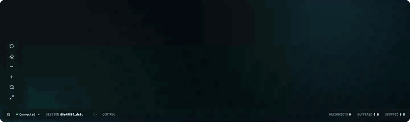

<p align="center">
  
</p>

<h1 align="center">WooTTY</h1>

<p align="center">A browser terminal for shells, coding agents, and long-running work.</p>

<p align="center">
  <a href="https://github.com/icoretech/wootty/actions/workflows/ci.yml"></a>
  <a href="https://github.com/icoretech/wootty/releases"></a>
  <a href="LICENSE"></a>
</p>

Run a command on your machine or server. Open its terminal in a browser. Reconnect to the same running process when the connection drops, or watch an active session from another tab.



## Start with Docker

Requires Docker and OpenSSL. This publishes the terminal only on your machine's loopback address and generates a fresh access token:

```bash
export WOOTTY_AUTH_TOKEN="$(openssl rand -hex 32)"
printf 'open http://127.0.0.1:8080/#token=%s\n' "$WOOTTY_AUTH_TOKEN"
docker run --rm -it \
  -p 127.0.0.1:8080:8080 \
  -e WOOTTY_AUTH_TOKEN \
  ghcr.io/icoretech/wootty:latest
```

Open the printed URL. WooTTY exchanges the fragment token for an HTTP-only cookie and removes it from the address bar. Treat that URL as a credential.

The default image gives you a Bash shell **inside the container**. To use tools and projects already installed on your host, [run from source](#run-from-source). For SSH, custom images, Compose, and reverse proxies, see the [runtime guide](docs/runtime.md).

## Keep work within reach

- **Resume a running session.** Automatic reconnect and bounded output replay help you recover from a dropped connection.
- **Keep tabs independent.** Each new browser tab starts its own session. Use the session menu to resume an existing one explicitly.
- **Watch without taking control.** An active session keeps its controller; another tab can attach as a read-only observer.
- **Use your terminal tools.** WooTTY launches a real PTY process, so shells, interactive coding agents, and terminal applications keep their normal workflow.
- **Give the terminal the screen.** Compact controls, keyboard shortcuts, adjustable text, and fullscreen keep output visible on desktop and mobile.
- **Run it where the work lives.** Use the Go server on Linux or macOS, or the container image. The browser connects over HTTP and WebSocket.

Sessions and replay buffers belong to **one server process**. The default detached retention is 24 hours; closing every browser tab does not immediately stop the command. A server restart or process exit ends the session. WooTTY does not provide persistent workspaces or session migration between replicas.

## Run from source

Requires Node.js 26+, pnpm matching [`package.json`](package.json), and Go matching [`apps/server/go.mod`](apps/server/go.mod). Use Linux or macOS; on Windows, use WSL or Docker for the server.

```bash
git clone https://github.com/icoretech/wootty.git
cd wootty
pnpm install --frozen-lockfile
pnpm dev
```

Open the Vite URL printed in the terminal, normally <http://localhost:5173>. The Go server uses loopback port `8080`, or the next available port; set `WOOTTY_PORT` to require a specific port.

Run a particular executable instead of the default shell:

```bash
WOOTTY_COMMAND=/bin/bash WOOTTY_COMMAND_ARGS='-l' pnpm dev
```

For an installed coding agent, set `WOOTTY_COMMAND` to its executable and `WOOTTY_CWD` to the project directory. Its login, filesystem access, and permissions come from the machine running WooTTY. The base container does not install coding agents or share your host credentials.

To build a standalone server with the web UI embedded:

```bash
pnpm build:binary
./apps/server/woottyd run --host 127.0.0.1 --port 8080 bash
```

Open <http://127.0.0.1:8080>. Direct CLI arguments after the command name are passed to that command. See [configuration and session retention](docs/runtime.md#configuration) for environment variables and server flags.

## Working in this repository

For contributors and coding agents, start with [AGENTS.md](AGENTS.md), then the nearest package instructions. The browser client is React + xterm.js; the server is Go + PTY. Shared wire contracts live in JSON and generate bindings for both runtimes.

| Change                                           | Start here                                                                            |
| ------------------------------------------------ | ------------------------------------------------------------------------------------- |
| Browser UI, transport, and session state         | [Web package instructions](apps/web/AGENTS.md)                                        |
| HTTP, authentication, PTYs, and session lifetime | [Server instructions](apps/server/AGENTS.md)                                          |
| Wire messages and shared constants               | [Contract sources](contracts)                                                         |
| Module boundaries and protocol behavior          | [Architecture](docs/architecture.md)                                                  |
| Test placement and test doubles                  | [Test instructions](apps/web/test/AGENTS.md)                                          |
| Requirements and executable coverage             | [UI specification](docs/web-ui-spec.md) · [Traceability](docs/web-ui-traceability.md) |

Use the existing commands from the repository root:

```bash
pnpm lint       # applies fixes, checks docs/contracts and React diagnostics, then types
pnpm run ci     # read-only lint, script/web/Go tests, build, and browser tests
```

Install the browser before the first E2E run: `pnpm --filter @icoretech/wootty-web exec playwright install chromium`. The optional cross-browser suite uses `pnpm test:e2e:cross` after installing Firefox and WebKit as well.

Change shared contracts in `contracts/`, then run `pnpm generate:terminal-contracts`. Change ownership and coverage manifests under `docs/governance/`, then run `pnpm generate:governance`. Keep generated files and their sources together. Full setup and review guidance lives in [CONTRIBUTING.md](CONTRIBUTING.md).

## Access and deployment

A terminal runs with the server process's permissions. Anyone holding the access token can reach its sessions; the token is not a per-user account or sandbox. Bind locally for personal use. For remote access, use HTTPS, set `WOOTTY_AUTH_TOKEN`, and restrict access to trusted operators. Keep each instance tied to its own session owner; a load balancer cannot move a PTY between servers.

See the [runtime guide](docs/runtime.md) for authentication, image variants, reverse proxies, Kubernetes, session limits, and shortcuts.

[Report a bug](https://github.com/icoretech/wootty/issues/new/choose) · [Report a vulnerability privately](SECURITY.md) · [MIT license](LICENSE)
