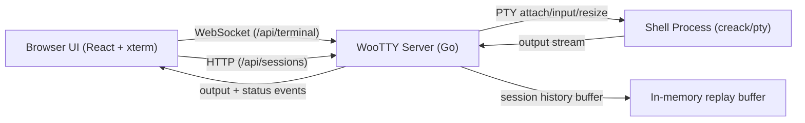

# Architecture

The web client and Go server share versioned JSON wire definitions in [contracts](../contracts). The server owns the PTY and session history; the browser owns rendering, local preferences, and reconnect behavior. Each live session belongs to one server process, with no cross-replica persistence or handoff.

## Server boundaries

| Responsibility | Implementation |
| --- | --- |
| HTTP assembly, health, session listing, and shutdown | [server.go](../apps/server/internal/server/server.go) |
| Cookie bootstrap, authentication, and host/origin policy | [auth.go](../apps/server/internal/server/auth.go) |
| Terminal WebSocket dispatch and connection lifecycle | [terminal.go](../apps/server/internal/server/terminal.go) |
| Rooted filesystem access and embedded static assets | [static.go](../apps/server/internal/server/static.go) |
| Session types, actions, and listing | [manager.go](../apps/server/internal/session/manager.go) |
| Attach/watch handshake and replay ordering | [attach.go](../apps/server/internal/session/attach.go) |
| Session detach, output, exit, and cleanup | [lifecycle.go](../apps/server/internal/session/lifecycle.go) |
| Serialized session connection writes | [connection.go](../apps/server/internal/session/connection.go) |
| CLI and environment configuration | [config.go](../apps/server/internal/config/config.go) |

## Frontend module ownership

This section is generated from [the ownership manifest](governance/terminal-governance-map.json). Change the manifest and run `pnpm generate:governance`. Requirement coverage is maintained in the [traceability matrix](web-ui-traceability.md).

<!-- governance:module-ownership:start -->
- `apps/web/src/App.tsx`: composition entrypoint that mounts the terminal feature app.
- `apps/web/src/features/terminal/app/TerminalApp.tsx`: terminal app entrypoint and top-level composition shell.
- `apps/web/src/features/terminal/app/composition/*`: app-level composition boundaries (platform, domain, and controller wiring) that join environment adapters with feature hooks.
- `apps/web/src/features/terminal/app/engine/*`: transport lifecycle, runtime boot/IO bridge, and connection state projection.
- `apps/web/src/features/terminal/app/bindings/*`: browser/document/window/session bindings (shortcuts, refresh cadence wiring, resize/fullscreen wiring, title updates).
- `apps/web/src/features/terminal/environment/*`: environment contracts shared by app bootstrap and controller layers.
- `apps/web/src/features/terminal/commands/*`: terminal command contract + registry ownership (UI actions and shortcut mapping).
- `apps/web/src/features/terminal/contracts/*`: shared terminal contracts (session + transport types and ready-state constants).
- `apps/web/src/features/terminal/platform/*`: platform-facing utilities shared by app/engine bindings (for example scheduler abstractions).
- `apps/web/src/features/terminal/components/*`: presentational controls, status bar, and session menu UI.
- `apps/web/src/features/terminal/view/*`: UI-facing formatting and presenter mapping for menu/session copy.
- `apps/web/src/features/terminal/commands/floating-controls/*`: floating-controls registry, metadata, and descriptor assembly.
- `apps/web/src/features/terminal/notifications/*`: user-facing terminal notice mapping.
- `apps/web/src/features/terminal/session/domain/*`: session candidate derivation and domain-level selection helpers.
- `apps/web/src/features/terminal/session/protocol/*`: session payload parsing and refresh failure protocol ownership.
- `apps/web/src/features/terminal/session/persistence/*`: storage adapters and storage key ownership.
- `apps/web/src/features/terminal/lib/*`: terminal-only utility helpers (formatting, outbox buffering).
- `apps/web/src/features/terminal/protocol/*`: protocol parsing owned by the terminal feature.
- `apps/web/src/features/terminal/adapters/*`: transport adapters owned by the terminal feature.
- `apps/web/src/features/terminal/runtime/*`: xterm runtime loading owned by the terminal feature.
<!-- governance:module-ownership:end -->

## Client protocol contract

The JSON definitions in `contracts/` generate shared TypeScript and Go bindings through `pnpm generate:terminal-contracts`. `apps/web/src/features/terminal/protocol/terminal-protocol.ts` owns client-side WebSocket payload parsing.

- Supported inbound message `type` values: `ready`, `output`, `exit`, `error`, `pong`.
- Required fields:
  - `ready`: `sessionId` (string), `readOnly` (boolean), `version` (must match `TERMINAL_WIRE_CONTRACT_VERSION`)
  - `output`: `data` (string)
  - `exit`: `code` (number), `signal` (number)
  - `error`: `message` (string), optional `code` (known server code string). Unknown non-empty codes are surfaced as `rawCode`.
  - `pong`: no additional fields
- Compatibility policy:
  - Additive fields are allowed and ignored by older clients.
  - Unknown message `type` values are treated as unsupported and surfaced as a user notice.
  - Invalid payload shapes are dropped by the parser and do not mutate terminal state.

## Transport lifecycle contract

Transport responsibilities are split by contract:

- `apps/web/src/features/terminal/contracts/transport/transport.ts` defines the transport surface and ready-state constants used by app runtime and test doubles.
- `apps/web/src/features/terminal/app/engine/transport/state/transport-policy.ts` defines heartbeat intervals, close codes, and reconnect delay policy.
- `apps/web/src/features/terminal/adapters/transport-event-normalizer.ts` adapts browser runtime events into typed contract payloads.

- Canonical ready states:
  - `TRANSPORT_READY_STATE.CONNECTING` (`0`)
  - `TRANSPORT_READY_STATE.OPEN` (`1`)
  - `TRANSPORT_READY_STATE.CLOSING` (`2`)
  - `TRANSPORT_READY_STATE.CLOSED` (`3`)
- Heartbeat policy:
  - Client sends `ping` every `12s` while connected.
  - Missing `pong` for `12s` triggers close code `4103` (`pong timeout`) and reconnect flow.
- Close/reconnect policy:
  - Manual reconnect closes with `4101`.
  - Starting a fresh session closes old transport with `4102`.
  - Backoff uses `reconnectDelayMs(attempt)` (`300ms * 1.8^attempt`, capped at `5000ms`).
  - Automatic recovery stops after eight failed attempts; manual reconnect remains available. Normal shutdowns and protocol/policy failures do not trigger automatic recovery.
